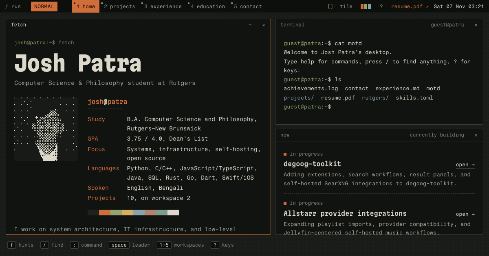

# Josh Patra's portfolio

[](https://app.netlify.com/sites/joshpatraportfolio/deploys)

A portfolio run as a Linux desktop with a tiling window manager. It boots, shows a fetch of the machine it is running on (your browser) at the login screen, logs in as `guest`, and opens on five workspaces: home, projects, experience, education and contact. Each window is a small app that holds one kind of content.



- **Mouse first, keyboard if you like.** Everything works by clicking, and on phones the windows stack in one column. Ctrl-h/j/k/l move between windows (Alt-h/j/k/l on Windows and Linux). With Vim keys on, `h j k l` move between the links, rows and fields inside a window and Enter opens one, `<Space>` opens a leader menu, `f` shows link hints and `:` opens a command line. `?` lists every key.
- **A working terminal.** `ls`, `cat`, `grep`, `tree`, `man`, `ps`, `kill`, `git log`, `neofetch` and more, all reading the same content as the windows.
- **A launcher.** `/` or ⌘K (Ctrl-K on Windows and Linux) fuzzy-finds workspaces, projects, links, windows, colorschemes and layouts. With Vim keys on it is modal, like telescope.nvim: Esc stops typing, `j k` move and `i` types again.
- **Three layouts and three colorschemes.** Tile, monocle and float; oxide, paper and sodium.
- **Fast.** Every project, job and course is in the prerendered HTML. The boot screen is CSS, so it starts with the first paint while the app loads behind it.

## Development

```sh
npm install
npm run dev      # http://localhost:5173
npm run check    # types and Svelte diagnostics
npm run build    # static site in build/
npm run preview  # serve the build
```

## Where things are

- `src/lib/content.ts`: the content. Profile, projects, experience, skills, courses and achievements all live here, and every window, the terminal and the launcher read from it.
- `src/lib/desktop/`: the desktop. `Desktop.svelte` is the markup and `engine.ts` the window manager; see [DESIGN.md](DESIGN.md) for the full map.
- `docs/decisions.md`: why things are the way they are, and how to undo each choice.

The site is built with SvelteKit and `adapter-static` and deployed on Netlify. Fragment Mono and Martian Mono are included under the SIL Open Font License (`src/lib/fonts`).
